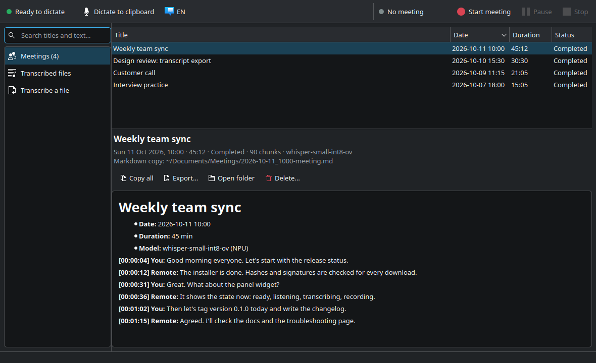

# BMeet

Voice typing, meeting transcripts and file transcription for **KDE Plasma 6**. Whisper
runs locally on the **Intel NPU** of Core Ultra laptops. It's fast, it stays on your
machine, and the CPU and GPU are left alone.

[](https://github.com/baakhoff/bmeet/actions/workflows/ci.yml)
[](https://github.com/baakhoff/bmeet/releases)
[](LICENSE)



## What you get

- **Dictation anywhere:**
  - Press **Meta+H**, speak, and press it again. The text is typed at the cursor in any app.
  - Speed: about 0.5 s for a 5 s sentence on the NPU.
- **Meeting transcripts, with who said what:**
  - Press **Meta+Alt+M** to record your microphone and the system audio. Each 30 s chunk is transcribed on the NPU while the meeting runs.
  - When you stop, a Markdown transcript is saved to `~/Documents/Meetings` right away.
  - A few minutes later it is replaced by one where the other side is split by voice: **You**, **Person 1**, **Person 2**, … Each line sits under whoever said it, in the order it was said, and the speech your microphone picked up from your speakers is left out. A 1-hour Russian meeting takes about 2 minutes on a Core Ultra 7 258V (other languages, with Whisper: ~8 minutes).
  - The audio is held in RAM only until that is done, then deleted. It never reaches the disk.
  - **Names:** *Name speakers…* in the app turns *Person 1* into *Viktor*. If you let it remember voices, later meetings call Viktor by name on their own.
- **File transcription:**
  - Run `npu-transcribe talk.mp4`, or right-click a file in Dolphin → *Transcribe (NPU)*. You get `.srt` subtitles and a readable `.md` transcript.
  - `--speakers` (or *Transcribe with speakers* in Dolphin) labels the lines Speaker 1, Speaker 2, …
  - Whisper large-v3-turbo runs at ~25x realtime on the NPU.
- **Russian with GigaAM v3** (Sber): about 20 % fewer word errors than Whisper on Russian conversation, at ~200x realtime on the NPU. It's used for Russian meetings and files automatically; English terms inside Russian speech come out worse than with Whisper (details in [docs/npu-transcribe.md](docs/npu-transcribe.md#russian-gigaam-v3)).
- **Everything on the NPU:** speech recognition, language detection and telling the speakers apart. The CPU only decodes audio and does small arithmetic.
- **BMeet app:**
  - Meeting history, transcribed files and a transcription queue, with search.
  - Export, copy and delete transcripts.
- **Panel widget:** a microphone icon that shows what is happening (ready, listening, transcribing, recording). Click it for dictation, meeting and language controls and your recent transcripts.
- **Several languages:** any language Whisper knows. **Meta+Shift+H** cycles through the ones you pick.

It builds on [voxtype](https://github.com/peteonrails/voxtype) (dictation and meetings) and
[OpenVINO GenAI](https://github.com/openvinotoolkit/openvino.genai) (Whisper on the NPU).
BMeet adds:
- the NPU setup,
- the KDE integration,
- the file transcriber,
- the app and the panel widget,
- a one-line installer.

## Requirements

- **CPU:** an Intel Core Ultra with an NPU (`/dev/accel/accel0`).
  - Tested on Lunar Lake (Core Ultra 7 258V).
  - Meteor Lake and Arrow Lake should work, but are untested.
  - Without an NPU, everything still works on the CPU, more slowly.
- **System:** Ubuntu or Kubuntu **26.04** (x86_64), with **KDE Plasma 6 on Wayland**.
- **Disk and network:** about 6 GB of free disk space, and internet access for the first install (~1.8 GB of downloads).

## Install

```bash
curl -fsSL https://raw.githubusercontent.com/baakhoff/bmeet/main/install.sh | bash
```

The installer asks for your sudo password once. It then:

1. **Installs packages:** voxtype 1.1.0, the OpenVINO GenAI SDK, ydotool, ffmpeg and PyQt6, plus Intel's NPU driver if it's missing.
   - Every download is checked against a pinned sha256.
   - voxtype and the NPU driver are also checked against their upstream GPG signatures.
2. **Sets up the Python side:** creates a Python venv and downloads the Whisper models (small, plus large-v3-turbo) from Hugging Face, pinned to tested revisions.
3. **Compiles for the NPU** once (about 1 minute).
4. **Adds the KDE integration:**
   - the keyboard shortcuts and the `voxtype` user service,
   - the Dolphin menu,
   - the BMeet app,
   - the panel widget, added to the bottom panel.

To pass options:

```bash
curl -fsSL https://raw.githubusercontent.com/baakhoff/bmeet/main/install.sh | bash -s -- --languages "en de"
```

| Option | |
|---|---|
| `--languages "en de"` | dictation languages for Meta+Shift+H (Whisper codes; default: English + your desktop language) |
| `--no-turbo` | skip Whisper large-v3-turbo (~1 GB); file transcription then uses small |
| `--no-speakers` | don't tell meeting speakers apart: transcripts keep the *You* / *Remote* labels, and no meeting audio is held, not even in RAM |
| `--no-gigaam` | skip GigaAM v3 (~480 MB): Russian is then transcribed with Whisper |
| `--no-panel` | don't add the widget to the panel |
| `--no-npu-driver` | don't install Intel's NPU driver |
| `--skip-system` | skip the sudo part (it must have run before) |
| `--reset-config` | replace your voxtype config with the default |

**From a checkout:** run `git clone https://github.com/baakhoff/bmeet && cd bmeet && ./install.sh`.

**Upgrading:** run the same command again. The installer is idempotent and keeps your settings.

## Use

| | |
|---|---|
| **Meta+H** | start dictation; press again to stop. The text is pasted at the cursor |
| **Meta+Alt+H** | same, but only copies to the clipboard (for terminals: then Ctrl+Shift+V) |
| **Meta+Alt+M** | start or stop a meeting transcript |
| **Meta+Shift+H** | next dictation language (restarts the engine, ~3 s) |
| Panel widget | click for controls; middle-click starts or stops a meeting |
| **BMeet** (app menu) | meetings, transcribed files, *Transcribe a file* |
| Dolphin | right-click audio or video → *Transcribe (NPU)*, or *Open With → BMeet* |

```bash
npu-transcribe interview.m4a                    # interview.srt + interview.md
npu-transcribe --speakers interview.m4a         # ... with Speaker 1, Speaker 2, ...
npu-transcribe --language de --translate a.ogg  # German speech -> English text
bmeet-ctl status                                # JSON state (what the widget shows)
voxtype meeting list                            # all meetings
```

**Shortcuts after a fresh install:** they're registered automatically, but KDE may only pick them up after you log out and in once.

## Configure

- **Dictation languages:** `~/.config/bmeet/languages`, for example `en de fr`.
- **Meeting speakers:** `~/.config/bmeet/speakers` says `on` or `off`. When two people end up as one, or one person is split in two, see [docs/troubleshooting.md](docs/troubleshooting.md#meeting-speakers).
- **Remembered voices:** off until you tick *Recognise them by voice in later meetings* in the app's *Name speakers…* dialog (stored in `~/.config/bmeet/remember-voices`).
- **voxtype:** `~/.config/voxtype/config.toml`. Change single values with `voxtype config set KEY VALUE`, then run `systemctl --user restart voxtype`. The defaults and the reasons for them are in [docs/voxtype.md](docs/voxtype.md).
- **Shortcuts:** System Settings → Keyboard → Shortcuts → *Voxtype: …*.

## Privacy

- **Local only:** audio is transcribed on your machine, and nothing is uploaded.
- **Meetings:** only the text is stored.
  - To tell the speakers apart, the meeting audio is recorded into RAM (`$XDG_RUNTIME_DIR`, a tmpfs; ~230 MB per hour) while the meeting runs. It is deleted as soon as the speaker pass ends, whether it succeeds, fails or is stopped. A logout or reboot clears it too.
  - Nothing is recorded while a meeting is paused.
  - `--no-speakers` turns this off.
- **Remembered voices (off unless you turn them on):**
  - BMeet then keeps a voice fingerprint per person, 192 numbers from which no audio or words can be recovered, in `~/.local/share/bmeet/voices` (only your user can read it).
  - That covers each meeting's people, plus the people you named, under their names (at most their last 10 meetings).
  - Fingerprints are biometric data about other people: turn it on only where that is fine.
  - *Remembered voices…* in the app forgets one person. Unticking the option forgets everyone, and so does the uninstaller.
- **Telemetry:** OpenVINO's telemetry is blocked in npu-transcribe (it's on by default upstream; see [docs/npu-transcribe.md](docs/npu-transcribe.md)). Hugging Face telemetry is turned off for the model download.
- **Clipboard:** dictation goes through the clipboard (that's how text gets into every app on KWin), so it shows up in Klipper's history.

## Uninstall

```bash
bash ~/.local/share/bmeet/src/uninstall.sh
```

- **What it removes:** everything the installer added, including the packages it installed, unless they were there before.
- **What it keeps:** your meeting transcripts, transcripts next to your files, and the Whisper and speaker models. Add `--purge` to also delete the models and caches. Intel's NPU driver also stays.

## How it fits together

```
 Meta+H / Meta+Alt+M ─┐
 panel widget (QML) ──┼─> bmeet-ctl ──> voxtype daemon ──> OpenVINO GenAI ──> NPU
 BMeet app (PyQt6) ───┘    (JSON)      (systemd --user)    (C SDK, /opt/intel)
         │
         └──────────────> npu-transcribe ──> OpenVINO GenAI (Python venv) ──> NPU, CPU fallback
                          (+ Dolphin menu)    GigaAM v3 for Russian ────────────> NPU
                                              speakers: pyannote + TitaNet ────> NPU

 meeting: voxtype-meeting-toggle ─> bmeet-meeting-audio (pw-record, RAM) ─> npu-transcribe --meeting
          (live You/Remote transcript from voxtype first, replaced by You/Person 1/... when done)
```

| Path | |
|---|---|
| [`install.sh`](install.sh), [`uninstall.sh`](uninstall.sh) | one-line installer / uninstaller |
| [`system/`](system) | the sudo part: packages, NPU driver, voxtype binary, OpenVINO SDK, uinput |
| [`voxtype/`](voxtype) | voxtype config, shortcuts, meeting and language helpers, `verify.sh` |
| [`transcribe/`](transcribe) | `npu-transcribe` and its tests |
| [`bmeet/`](bmeet) | `bmeet-ctl`, the BMeet app and the Plasma widget |
| [`docs/`](docs) | design notes, benchmarks, troubleshooting |

## Development

```bash
bmeet/app/tests/run-tests.sh --quick              # app + bmeet-ctl, offscreen, no NPU needed
bmeet/app/tests/run-tests.sh                      # + real Whisper runs on the NPU
bmeet/plasmoid/tests/check_qml.py --strict bmeet/plasmoid/*/contents/ui/*.qml
transcribe/tests/run-tests.sh /tmp/npt "NPU CPU"  # npu-transcribe benchmark / regression
transcribe/tests/meeting_test.py /tmp/npt         # meeting speaker pass (ru; --language en)
bash voxtype/verify.sh                            # health check of an installed system
```

The tests never record audio. They use synthetic speech from espeak-ng and a scratch
database, and never open your real one.

## Known limitations

- **whisper-large-v3-turbo fails inside voxtype on the NPU,** so dictation uses whisper-small. npu-transcribe runs turbo fine.
- **One language per dictation session:** the OpenVINO engine has no auto-detection. Switch with Meta+Shift+H. File transcription does detect the language.
- **voxtype can't rename meetings yet.**
- **Speakers:**
  - Only the system audio is split by voice. Everyone on your microphone (people in the same room) is *You*.
  - When two people talk at the same time, the words go to whoever is louder.
  - People are numbered until you name them in the app; only remembered voices are named automatically.
- **Opening the app from the widget** may only flash it in the task bar (Wayland focus-stealing prevention).
- **Only Ubuntu/Kubuntu 26.04 has been tested;** the pinned packages are built for it.

More in [docs/troubleshooting.md](docs/troubleshooting.md).

## Credits

- [voxtype](https://github.com/peteonrails/voxtype) (peteonrails/voxtype).
- [OpenVINO](https://github.com/openvinotoolkit/openvino) and the [Intel NPU driver](https://github.com/intel/linux-npu-driver) by Intel.
- [Whisper](https://github.com/openai/whisper) by OpenAI, in the int8 OpenVINO exports from [huggingface.co/OpenVINO](https://huggingface.co/OpenVINO).
- [GigaAM v3](https://github.com/salute-developers/GigaAM) by Sber (MIT): Russian speech recognition.
- [pyannote segmentation-3.0](https://huggingface.co/pyannote/segmentation-3.0) (MIT) and NVIDIA's [TitaNet-small](https://catalog.ngc.nvidia.com/orgs/nvidia/teams/nemo/models/titanet_small) (CC-BY-4.0): the speaker models.
- [sherpa-onnx](https://github.com/k2-fsa/sherpa-onnx) (Apache-2.0): the ONNX exports of these models, and the GTCRN speech enhancement model.

They're downloaded at install time under their own licenses. This repository is [MIT](LICENSE).
