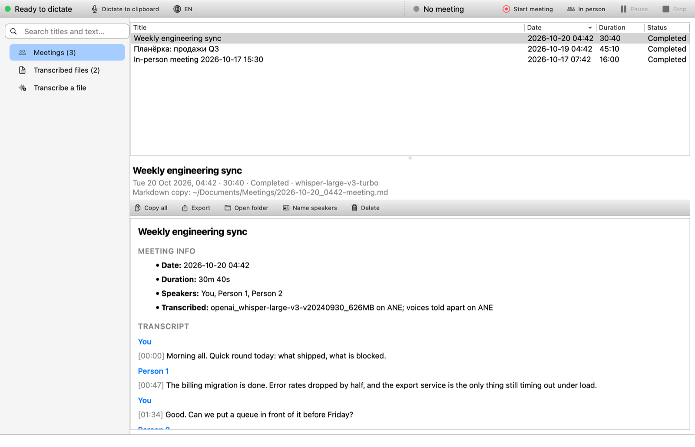
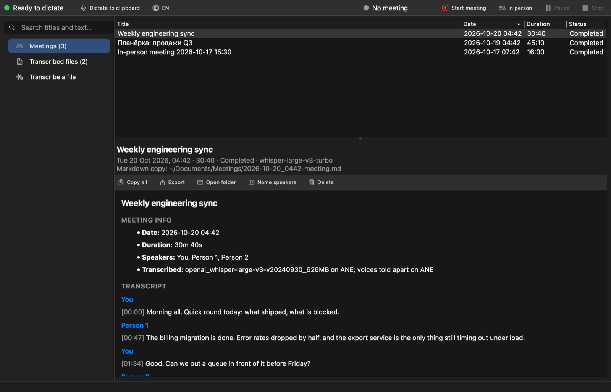
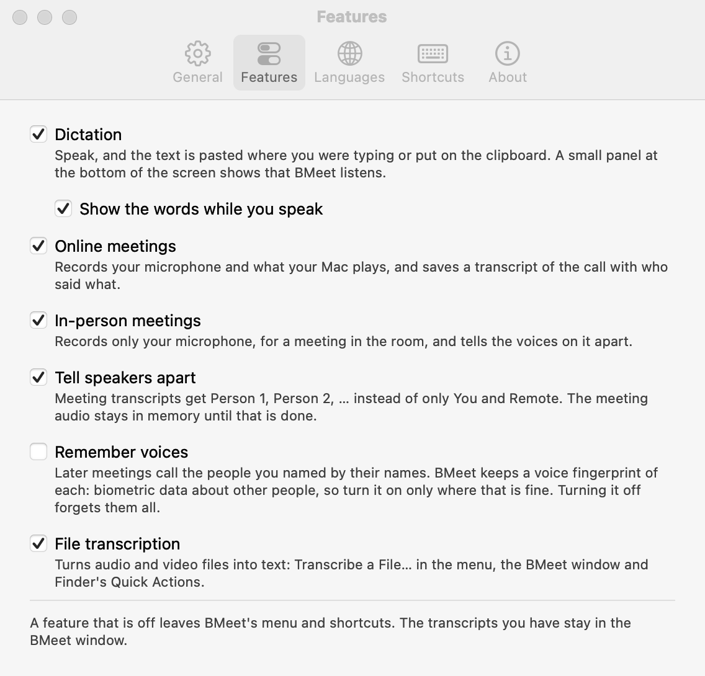

# BMeet on macOS (Apple silicon)

BMeet runs on Macs with Apple silicon (M1 and later) with macOS 14.2 or later. On Linux the speech models run on the Intel NPU. On a Mac they run on the **Neural Engine**, Apple's NPU, and the CPU is only the fallback. The features are the same:
- dictation;
- meeting transcripts with who said what;
- in-person meetings;
- file transcription;
- the app;
- the Chrome mute extension.

The transcription engine (`transcribe/npu-transcribe`), the app and the Chrome extension are shared with Linux. The Mac-only parts live in `macos/`.



## Install

The installer is the same one line as on Linux. On a Mac `install.sh` hands over to `macos/install.sh`:

```bash
curl -fsSL https://raw.githubusercontent.com/baakhoff/bmeet/main/install.sh | bash
```

It installs the latest release of BMeet for macOS. The Mac has a release line of its own, separate from Linux: its version is `macos/VERSION`, its releases are the tags `macos-vX.Y.Z`, and what changed is in [macos/CHANGELOG.md](../macos/CHANGELOG.md). How a release is made: [releasing.md](releasing.md).

It goes through nine numbered steps, each with a ✓ and how long it took, a spinner for the long ones and their details in `~/Library/Logs/BMeet/install.log` (on a failure, the last lines of it are shown). Starting from a new Mac:

- **Command Line Tools missing:** macOS shows its own window to install them, and the installer waits.
- **Homebrew missing:** it offers to run Homebrew's official installer, which asks for your password itself.

To try a branch before it is released, name it (`BRANCH` below; `main` is the code that will be in the next release):

```bash
curl -fsSL https://raw.githubusercontent.com/baakhoff/bmeet/main/install.sh | BMEET_REF=BRANCH bash
```

What it needs and what it does:

- **Needs:**
  - the Command Line Tools (`xcode-select --install`; Xcode itself is not needed);
  - [Homebrew](https://brew.sh);
  - about 5 GB of free disk.
  - No sudo.
- **Installs:**
  - `python@3.13` and `ffmpeg` with Homebrew;
  - a Python venv in `~/.local/share/bmeet/venv`;
  - the models in `~/.local/share/npu-models` (about 1.6 GB, every download checked against a pinned hash);
  - `~/Applications/BMeet.app`;
  - `npu-transcribe`, `bmeet-ctl` and `bmeet` in `~/.local/bin`.
- **Builds:**
  - BMeet's Swift parts, with the Command Line Tools;
  - the Core ML versions of GigaAM and the speaker models (`macos/prepare-coreml`, a few minutes).
- **Warms up:** macOS compiles each model for the Neural Engine the first time it is loaded (Whisper turbo: about 2 minutes on an M1). The installer does that once at the end, so the first dictation does not wait.

Options are the Linux ones that apply: `--languages "en ru"`, `--no-turbo`, `--no-speakers`, `--no-gigaam`, plus `--no-start` (do not start BMeet.app, and not at login) and `--skip-system` (no Homebrew packages). **Update:** when a new release of BMeet for macOS is out, BMeet's menu shows **Update to BMeet X…**, and a notification says so once. It opens Terminal with the new release's installer, which uses the options you installed with. BMeet asks GitHub once a day; *Check for updates automatically* in Settings → General turns that off, and *Check for Updates…* in the menu (or *Check Now* on the About page of the Settings window) asks now. In Terminal: `bmeet-ctl update` (or `--check` to only look). Running the install line again works too. **Uninstall:** `bash ~/.local/share/bmeet/src/uninstall.sh` (`--purge` also deletes the models).

### Permissions

macOS asks once for each, the first time BMeet needs it. They are all for **BMeet**, because everything that records, pastes or saves runs inside BMeet.app.

| Permission | When it is asked | Without it |
|---|---|---|
| Microphone | the first dictation or meeting | nothing can be recorded |
| System Audio Recording | the first meeting | the other side of a call is silent: only *You* is transcribed |
| Accessibility | the first dictation that should be pasted | the text stays on the clipboard (press ⌘V); BMeet says so |
| Documents folder | the first meeting transcript | it is saved in `~/.local/share/bmeet/meetings` instead, where the window and `bmeet-ctl` find it too; BMeet says so |

**iCloud:** the transcripts go to `~/Documents/Meetings`. If iCloud Drive syncs your Desktop and Documents folders (System Settings → Apple Account → iCloud → iCloud Drive), it uploads them too. The installer tells you when that setting is on. The audio is never saved, so it is never uploaded.

They can be changed later in System Settings → Privacy & Security. BMeet is signed "ad hoc" (no Apple developer certificate), so after an upgrade macOS may ask for them again. To avoid that, sign with an identity of your own: run the installer with `BMEET_SIGN_IDENTITY="Your identity" ./install.sh` (`security find-identity -p codesigning` lists yours).

## Use

BMeet lives in the menu bar: a microphone. It turns red while you dictate or a meeting records, and shows the meeting's time.

| | |
|---|---|
| **⌃⌥H** | dictate: press, speak, press again. The text is pasted where you were typing |
| **⌃⌥⌘H** | the same, but only copied to the clipboard |
| **⌃⌥M** | start or stop a meeting transcript (microphone + system audio) |
| **⌃⌥⇧M** | start or stop an in-person meeting (microphone only, split by voice) |
| **⌃⌥⇧H** | next dictation language |
| Menu bar icon | the same, plus pause and resume, languages, recent transcripts, *Open BMeet…*, *Settings… ⌘,* (the [Settings window](#settings)) |
| Finder | right-click audio or video → *Quick Actions* or *Services* → *Transcribe with BMeet*, *… with Speakers*, *Translate Speech to English*, *Open in BMeet* |
| Terminal | `npu-transcribe talk.m4a`, `bmeet-ctl status`, `bmeet` (the window), as on Linux |

A feature turned off in Settings → Features is gone from the menu and its shortcuts are free for other apps; the menu shows only what is on (with everything off, its first line says so). A meeting that runs can always be stopped from the menu, even with meetings turned off.

While you dictate, a small panel at the bottom of the screen shows the words as you say them. It is underlined while a word may still change, and it floats over full-screen apps too. It never takes the keyboard focus, so the text goes where you were typing. When you stop, BMeet puts the text on the clipboard, presses ⌘V, and gives you your clipboard back. `~/.config/bmeet/live-dictation` saying `off` hides the words (the panel then only shows *Listening…*).

### How it looks

- **The window:** the same window as on Linux, dressed as a Mac app.
  - Its icons are SF Symbols, drawn on your Mac by the installer (`macos/tools/make-symbols.swift`), in light and dark versions.
  - A Finder-style sidebar, Apple's system colors for the states.
  - Transcripts in macOS's type: small gray section labels, the speakers in accent blue, the times in gray.
  - The menus a Mac app has: *View* → Meetings ⌘1, Transcribed Files ⌘2, Transcribe a File ⌘3; ⌘F to search, ⌘O to transcribe files; *Controls* for dictation and meetings. *Settings…* (⌘,) and *About BMeet* open BMeet's Settings window (`bmeet-ctl settings`, `bmeet-ctl settings about`); a BMeet.app that does not answer gets the settings folder instead.
  - Its texts name ⌃⌥ and Finder where Linux's name Meta and Dolphin.
  - It speaks BMeet's interface language, English or Russian, and so do the meeting notifications; after a change, the open window offers **Restart**.
  - A feature turned off in the settings (dictation, online or in-person meetings, file transcription) leaves the window while it is open, with its menu items and shortcuts (⌘3, ⌘O). The Meetings and Transcribed Files pages keep listing what was made.
  - *Transcribe a File* offers the engine: *Automatic* (GigaAM v3 for Russian), *GigaAM v3*, *Whisper turbo*, *Whisper small* ([npu-transcribe.md](npu-transcribe.md)).
- **The menu bar:** each item has an SF Symbol, and the shortcuts show the Mac way, from the same `hotkeys` file. The first line shows the state with a colored dot.
- **The dictation panel:** a red dot pulses while BMeet listens, next to the language.
- **The Settings window:** a toolbar with five pages, as in Apple's own apps (below).



## Settings



**Settings… ⌘,** in BMeet's menu opens BMeet's Settings window; *About BMeet* opens it on the About page, and `bmeet-ctl settings [general|features|languages|shortcuts|about]` on the page it names. Each control saves at once, into its file in `~/.config/bmeet` (the same files as on Linux, one value per file, a missing file meaning the default), and BMeet follows it at once: a shortcut is registered again, a menu item comes or goes, without a restart. BMeet also follows changes made to those files by hand, within two seconds. The BMeet window and `bmeet-ctl` read the same files.

| Page | What is on it |
|---|---|
| **General** | *Language*: BMeet's interface language, *System*, *English* or *Русский* (`interface-language`). *Start BMeet at login* (`start-at-login`). *Check for updates automatically* (`update-check`). *Free memory after*: right after use, 1, 5 (the default), 15, 30 or 60 minutes (`unload-after`): how long a speech model stays in memory after its last use; loading Whisper turbo again takes a few seconds, and a few minutes the first time after an update, while macOS compiles it. *Pasting*: whether macOS lets BMeet paste (Accessibility), with *Allow Pasting…* (shown while dictation is on). *Open in Finder* for the settings folder |
| **Features** | Switches for **dictation** (`dictation`, with *Show the words while you speak*, `live-dictation`, under it while dictation is on), **online meetings** (`meetings`), **in-person meetings** (`in-person-meetings`), *Tell speakers apart* (`speakers`), *Remember voices* (`remember-voices`) and **file transcription** (`file-transcription`), each with a line on what it does |
| **Languages** | The dictation language, chosen among the ones that are on (`language`), and every language Whisper knows with a switch (`languages`), searchable by name or code, names in the interface language, the ones on first. At least one stays on; when the current one is turned off, the first one left takes its place. A note says that Russian goes to GigaAM v3 (or to Whisper, without it) |
| **Shortcuts** | Each of the five shortcuts, changed by clicking it and pressing the new keys (⌃, ⌥ or ⌘ with a letter, a digit or Space, or an F key alone); ⌫ turns one off, Esc keeps it, *Restore Defaults* (`hotkeys`). Keys that another of BMeet's shortcuts has are refused; a shortcut another app holds says *Taken by another app*. The shortcuts of a feature that is off are greyed: *Off on the Features page* |
| **About** | The version, whether a newer release is out with **Check Now** or **Update…** (as the menu's update items), *What's New* (the new release's notes, else this changelog), the models installed and their licences (Whisper and WhisperKit: MIT; GigaAM v3: MIT; Nemotron 3 Diarization: OpenMDW-1.1; TitaNet-small: CC-BY-4.0; BMeet: MIT), github.com/baakhoff/bmeet and *Open Log Folder* |

**A feature that is off** is gone everywhere in BMeet.app, and comes back when it is turned on:

| Off | What goes |
|---|---|
| Dictation | ⌃⌥H, ⌃⌥⌘H and ⌃⌥⇧H are not registered; the dictation items and the language submenu leave the menu; the panel never shows; a dictation that runs is cancelled and the speech engine ends; `{"op": "dictate"}` on the control socket answers `{"ok": false, "error": "dictation is off (BMeet's Settings → Features)"}` |
| Online meetings | ⌃⌥M is not registered; *Start Meeting* leaves the menu; `{"op": "meeting"}` refuses to start one (`"meetings are off …"`), but stops, pauses and resumes one that runs |
| In-person meetings | the same for ⌃⌥⇧M, *Start In-Person Meeting* and `"in_person": true` |
| File transcription | *Transcribe a File…* leaves the menu. Finder's four services and *Open With → BMeet* stay in Finder: macOS takes them from BMeet.app's signed Info.plist, and an app cannot hide its own services while it runs (you can, in System Settings → Keyboard → Keyboard Shortcuts → Services). Choosing one gives a notification that file transcription is off, and nothing is transcribed |

The meetings and files transcribed before stay in the BMeet window and in *Recent Transcripts*. The menu bar icon is the microphone while dictation or a kind of meeting is on, and a waveform with file transcription alone.

**Remembered voices** are turned on in Settings only after a question that says what is kept: a voice fingerprint per person, biometric data about other people (the README's Privacy section). Turning them off forgets every fingerprint, after a question when there are some, as in the BMeet window's *Name speakers…*.

**The interface language** (`interface-language`): *System* is the first of the Mac's languages that BMeet comes in (or the language chosen for BMeet alone in System Settings → General → Language & Region), else English. Changing it changes BMeet's menu, an open Settings window and BMeet's notifications at once. macOS decides some texts by the Mac's own language instead: the app's name, the titles of Finder's services (Russian ones on a Mac whose language is Russian), the questions for the permissions, and AppKit's own texts such as a text field's *Copy* and *Paste*. Command-line output and the contents of transcripts (*You*, *Person 1*) stay English. The Russian texts are `macos/app/ru.lproj` in the source; `macos/tools/check-strings.py` checks in CI that every text has its line.

| File | |
|---|---|
| `dictation`, `meetings`, `in-person-meetings`, `file-transcription` | `on` (default) / `off`: the features above |
| `languages` | the dictation languages ⌃⌥⇧H cycles through, in this order, e.g. `en ru` (the installer's default: English + your Mac's languages); never empty |
| `language` | the current dictation language, one of `languages` (on Linux it is in voxtype's config) |
| `interface-language` | `system` (default), `en` or `ru` |
| `unload-after` | minutes, 0–60 (default 5): how long a process that waits for work keeps a model after its last use; `0`: right after each use. BMeet.app ends its speech engine after that long without a dictation ([Memory](#memory)) |
| `live-dictation` | `on` (default on a Mac) or `off`: the words while you speak |
| `speakers` | `on` / `off`: tell meeting speakers apart (Person 1, Person 2, …) |
| `remember-voices` | `on` / `off` (default): as on Linux; also set in the window's *Name speakers…* |
| `start-at-login` | `on` / `off` |
| `update-check` | `on` (default) / `off`: the daily look for a newer release |
| `hotkeys` | the shortcuts that differ from the defaults, one per line: `dictate = ctrl+option+h`, `dictate-clipboard`, `language`, `meeting`, `meeting-in-person`; modifiers `ctrl`, `option`, `cmd`, `shift`, a key `a`–`z`, `0`–`9`, `space` or `f1`–`f20`; `none` turns one off. Settings → Shortcuts writes it |

## How it works

```
 ⌃⌥H / menu ──┐
 ⌃⌥M / menu ──┼─> BMeet.app (menu bar, Swift) ─┬─> npu-transcribe --dictate ──> bmeet-record raw (microphone)
 bmeet-ctl ───┘   agent.sock                   │       text events -> the panel; ⌘V at the end
                                               └─> bmeet-meeting start|stop (Python)
                                                     ├─ RAM disk on $XDG_RUNTIME_DIR/bmeet/meeting-audio
                                                     ├─ bmeet-record meeting DIR   (mic + Core Audio tap of the system audio)
                                                     ├─ npu-transcribe --live DIR  (live.md: You / Remote)
                                                     └─ npu-transcribe --meeting   (the speaker pass) -> ~/Documents/Meetings

 npu-transcribe ─┬─> bmeet-whisper (WhisperKit, Core ML, one server for all) ──────────> Neural Engine
                 ├─> GigaAM v3 (Core ML program built by macos/prepare-coreml) ────────> Neural Engine
                 └─> Nemotron 3 Diarization + TitaNet (Core ML programs) ──────────────> Neural Engine
```

| Linux | macOS |
|---|---|
| Whisper with OpenVINO GenAI on the NPU, in each process | **bmeet-whisper** (`macos/Sources/bmeet-whisper`): [WhisperKit](https://github.com/argmaxinc/argmax-oss-swift) (Argmax, MIT) runs Whisper large-v3-turbo as Core ML models, encoder and decoder on the Neural Engine. One server holds the model for every process: an 8 GB Mac loads it once. Dictation goes first, then the live transcript, then files. It releases a model `unload-after` minutes after its last use, at once when macOS says memory is short, and exits once it has held no model for 10 minutes ([Memory](#memory)). The models are pinned in `macos/models/whisperkit.tsv` (`openai_whisper-large-v3-v20240930_626MB`, and `openai_whisper-small_216MB` for `--translate`) |
| GigaAM, Nemotron, TitaNet with OpenVINO on the NPU | the same pinned files, built into **Core ML programs** by `macos/prepare-coreml` (see below) and run with coremltools on the Neural Engine |
| voxtype: the dictation daemon and meetings | **BMeet.app**: dictation, through the same `npu-transcribe --dictate` engine as the Linux text-while-you-speak. **`macos/bmeet-meeting`**: meetings, with voxtype's state files and voxtype's meeting index columns (`~/.local/share/bmeet/meetings/index.db`), so bmeet-ctl and the app read both alike |
| pw-record, bmeet-meeting-audio | **bmeet-record** (`macos/Sources/bmeet-record`): the microphone (AVAudioEngine) and the system audio, a Core Audio process tap of every process (macOS 14.2+). Both are written as 16 kHz mono WAV parts, the layout of bmeet-meeting-audio, and lined up by their hardware timestamps |
| `$XDG_RUNTIME_DIR` (tmpfs) | macOS has no such variable: `macos/bmeetmac.py` points it at your user's temp folder, the same for every process. The meeting audio goes to a RAM disk that bmeet-meeting mounts there (hidden from Finder) and detaches when no recording is left: it never reaches the disk |
| systemd user units | bmeet-meeting's "units": detached processes with pid files in `$XDG_RUNTIME_DIR/bmeet/units`, and what to run when each ends |
| KDE shortcuts, the panel widget | BMeet.app's shortcuts (Carbon hot keys: no Input Monitoring permission) and its menu bar icon |
| ydotool / wl-copy, KWin's input method | the clipboard, ⌘V (CGEvent; Accessibility), and the panel at the bottom of the screen |
| Dolphin service menu | BMeet.app's Services (Finder → Quick Actions / Services) |
| notify-send | BMeet.app's notifications (`bmeetmac.notify`) |
| The app on the system PyQt6 | the same app on the venv's PyQt6, inside `BMeet.app/Contents/Helpers/BMeet Window.app`: `macos/window/launcher.c` runs Python inside that bundle, so macOS shows *BMeet* with its icon, not *Python* |

### The models on the Neural Engine

The Neural Engine computes in float16 and only Core ML can reach it. ONNX Runtime's Core ML backend keeps an ONNX model in float32 and so leaves it on the CPU. On an M1, TitaNet ran exactly as fast with the Neural Engine allowed as without, and its output was bit-identical to the CPU's. So `macos/prepare-coreml` builds real Core ML programs at install time:

- **GigaAM v3 and TitaNet:** the ONNX model gets fixed input shapes and is constant-folded by ONNX Runtime's basic optimiser, which turns all shape arithmetic into constants. It is then translated op by op into an ML Program (`OnnxToMil`: the ~35 ONNX ops these two use) and saved with float16 compute precision. GigaAM's int8 weights are turned back into float first, by `prepare-models`' `dequantize`, as for the NPU. TitaNet gets the same float16 fix as on the NPU (`titanet_fp16_safe`: its statistics pooling underflows in float16).
- **Nemotron 3 Diarization:** built from its weights by `transcribe/prepare-diarization`'s own graph code (`build_graph`), with Core ML ops in place of OpenVINO's (`MilOps`). It is the same model as on the NPU.
- **Checks:** each build is checked against the CPU, and Core ML's compute plan is asked where each op runs.

Measured on an M1 with 8 GB (macOS 27):

| Model | On the Neural Engine | Check against the CPU |
|---|---|---|
| Whisper large-v3-turbo (WhisperKit 626 MB) | a 23 s English talk in 3.0 s (7.7× real time), every word right; first load ever 137 s, then 1.7 s | — |
| GigaAM v3 | 112 ms per 30 s block (~270× real time); 1148 of 1162 ops on the Neural Engine | 100 % of the output frames agree |
| TitaNet-small | 44 ms per 16 fingerprints (the CPU: 420 ms); 132 of 156 ops | 0.9998 alike at worst |
| Nemotron 3 Diarization | 72 ms per 27 s step; 1137 of 1140 ops | 100 % of the 10 ms voice decisions agree with float32 |
| A 20 s meeting's speaker pass | 8 s, 1 s of CPU | — |

Whisper is the slow part. A 30 s window takes about 1 s in the encoder and ~30 tokens per second in the decoder. That is slower than the GPU would be, and that is the point: like the NPU on Linux, it leaves the CPU and the GPU to your calls and apps. Russian goes to GigaAM, which is ~35× faster than Whisper.

### Memory

BMeet keeps a model loaded only while it may be needed soon. One setting says how long: `~/.config/bmeet/unload-after`, in minutes. It goes from 0 to 60, the default is 5, and `0` releases a model right after each use. Every process reads it when it decides, so a change applies at once.

| Process | Holds | Lets go |
|---|---|---|
| **bmeet-whisper** | Whisper turbo, and small when something translates, for every process | each model `unload-after` after its last use; small, and a copy on the CPU, after at most 3 minutes; every model when macOS says memory is short. The process exits once it has held no model and had no work for 10 minutes |
| **the dictation engine** (`npu-transcribe --dictate`, run by BMeet.app) | GigaAM for Russian (for other languages it is only a client of bmeet-whisper) | `unload-after` after the last dictation, or when macOS says memory is short. BMeet.app ends the engine after the same time without a dictation |
| **the live transcript** (`bmeet-live`) | GigaAM, or a client of bmeet-whisper | when the meeting ends |
| **the speaker pass, file transcriptions** | GigaAM, Nemotron, TitaNet (Whisper through bmeet-whisper) | when they end |
| BMeet.app, the window | no model | – |

- **Only real use counts:** for bmeet-whisper, a use is a request that transcribes, detects a language or loads a model. Asking for its status, `{"op": "unload"}`, or a client that only checks whether it is up keeps nothing loaded and does not keep the server running. Its `status` lists what is loaded, since when, and how long until it goes.
- **The install's model keeps its time:** turbo (small, on an install without turbo) gets the whole of `unload-after`, whatever was used last. A translation with small no longer makes turbo the model that goes first.
- **Memory pressure:** bmeet-whisper listens to macOS's memory-pressure events (warning and critical). It releases every model as soon as the request that runs, if one does, is done, and logs it in `whisper.log`. The dictation engine reads the same level (`kern.memorystatus_vm_pressure_level`) when it looks at the setting, every 30 s while it holds a model. That is one system call and no process, and without a model it does not wake at all.
- **No idle copies:** GigaAM can be loaded in up to three processes while they work: a dictation during a meeting, with the speaker pass of the meeting before it still running. Once the dictation engine waits, its copy goes by the setting; the other two end with their work.
- **Files from Finder:** each request of Finder's services starts its own run, side by side. `npu-transcribe --queue` makes runs wait for one another; the services do not pass it yet.
- **What a reload costs** (M5 Pro, macOS 27.2, private servers of the installed bmeet-whisper):
  - Once macOS has compiled turbo for a bmeet-whisper binary, a new server process loads it in 2.6 s, and the same process loads it again after a release in 2.5 s (small: 1.3 s). So a release costs a few seconds at the next use, whether the server is still up or has exited.
  - The compile itself took ~190 s here (small: 46 s). It happens once per bmeet-whisper binary: the installer's warm-up does it after an update that rebuilds the server. A bmeet-whisper of another build that loads the models under the same name (a development build) has macOS compile them again for itself, and the installed one then compiles once more at its next load.
  - GigaAM loads in a fraction of a second once compiled (0.2-0.4 s in the logs).
- **What it frees:** `footprint` shows the server at ~70 MB with turbo loaded and about the same after the release. The weights the Neural Engine runs are not counted in a process's footprint, so how much a release frees is not shown there.
- **Tests only:** `BMEET_UNLOAD_AFTER_SECONDS` gives the time in seconds. `BMEET_WHISPER_TEST=1` gives bmeet-whisper stand-in models and an op that does what a memory-pressure event does.

## Differences from Linux

- **No text into the field while you speak:** on Linux BMeet can be KWin's input method. On a Mac the words show in the floating panel and are pasted when you stop.
- **No pyannote fallback** for telling voices apart. The Mac install always has Nemotron, and ONNX Runtime, which pyannote would need, crashes next to Core ML in one process.
- **One Whisper model:** dictation uses Whisper turbo, like files and meetings; Linux's voxtype uses Whisper small. It is fast enough on the Neural Engine, and it is already loaded.
- **The meeting audio is always recorded while a meeting runs** (in RAM): there is no voxtype that transcribes it itself. With `speakers` off it is deleted as soon as the live transcript is done, instead of after the speaker pass.
- **A Settings window:** the Mac has BMeet.app's; on Linux the same files in `~/.config/bmeet` are written by hand.

## Development

```bash
swift build -c release --package-path macos                 # BMeet, bmeet-whisper, bmeet-record (Command Line Tools)
macos/.build/release/bmeet-whisper transcribe talk.f32 --words   # raw float32 16 kHz mono -> JSON
QT_QPA_PLATFORM=offscreen ~/.local/share/bmeet/venv/bin/python -I bmeet/app/tests/test_bmeet.py   # the app's tests
~/.local/share/bmeet/venv/bin/python -I macos/tests/test_macos.py                               # the Mac parts
python3 -I macos/tests/test_settings.py                                                        # BMeet.app's Settings window
python3 -I macos/tools/check-strings.py                                                        # BMeet.app's Russian texts
```

- The app's tests run the Linux window with a fake voxtype on a Mac too: they set `BMEET_PLATFORM=linux`, which bmeet-ctl and the app read.
- `macos/tests/test_macos.py` tests the Mac parts without models or permissions:
  - the WhisperKit server protocol, with a stand-in;
  - bmeet-record, playing files instead of the devices (`BMEET_RECORD_MIC_FILE`, `BMEET_RECORD_SYSTEM_FILE`): parts, pauses, WAV headers;
  - bmeet-meeting's start, pause, stop and index, without the RAM disk (`BMEET_NO_RAMDISK=1`), and a speaker pass that fails or is killed;
  - bmeet-whisper's memory: idle release, `unload`, the setting, memory pressure, with stand-in models (`BMEET_WHISPER_TEST=1`);
  - bmeet-ctl's Mac commands.
  - Everything they start gets a runtime folder of its own (`BMEET_RUNTIME_ROOT`), and notifications go to a file (`BMEET_NOTIFY_LOG`), so nothing reaches the BMeet.app running on that Mac or its screen.
  - `CoreMLInputs` runs the installed GigaAM, Nemotron and TitaNet on speech made with `say`, with pauses longer than Core ML takes to let go of a prediction's inputs. It runs only where the models are installed (not in CI).
- `macos/tests/test_settings.py` drives BMeet's own check modes (`BMeet --help` lists them), which show nothing and need a test's own `XDG_CONFIG_HOME` and `BMEET_RUNTIME_ROOT`:
  - `--settings-check PAGE|all --lang en|ru`: each page of the Settings window built off screen, in both languages: at most 600 points tall, no text cut short, every text translated. `--picture DIR` draws the window into PNG files (`docs/macos-settings.png` is one);
  - `--menu-check`: the menu and the shortcuts for the settings in that folder, so turning each feature off removes exactly its items and shortcuts;
  - `--settings-act`: the Settings window's controls worked as a click or a key press would, and the files they wrote;
  - `--control-check`: the control socket with a stand-in for BMeet's Python, so nothing records: the `settings` op, and `dictate` and `meeting` refusing what is off;
  - `--hotkey-check`: shortcuts registered with macOS again as the switches change, with ⌃⌥⇧⌘ and F13–F20 only, which nobody uses.
- The native parts build with the Command Line Tools alone (`swift build`). WhisperKit is pinned in `macos/Package.resolved`.

## Troubleshooting

- **Nothing happens on ⌃⌥H:**
  - Is BMeet in the menu bar? If not, open `~/Applications/BMeet.app`.
  - Is dictation on? Settings → Features.
  - Is the shortcut taken? Settings → Shortcuts says *Taken by another app*; pick other keys there (`~/Library/Logs/BMeet/BMeet.log` names it too).
- **The dictated text does not appear:** allow BMeet in System Settings → Privacy & Security → Accessibility (Settings → General → *Allow Pasting…*). Until then, the text is on the clipboard.
- **A meeting has only *You*:** allow BMeet in System Settings → Privacy & Security → *Screen & System Audio Recording*, under *System Audio Recording Only*.
- **Logs:**
  - `~/Library/Logs/BMeet/` (dictation, meetings, file jobs);
  - `$(getconf DARWIN_USER_TEMP_DIR)bmeet/whisper.log` (the Whisper server);
  - `$(getconf DARWIN_USER_TEMP_DIR)bmeet/units/*.log` (a meeting's recorder, live transcript, speaker pass).
- **Check everything:** `bash ~/.local/share/bmeet/src/macos/verify.sh`
- **Ask for a permission again:** `tccutil reset Microphone io.github.baakhoff.bmeet`, and the same with `Accessibility` or `AudioCapture`.
