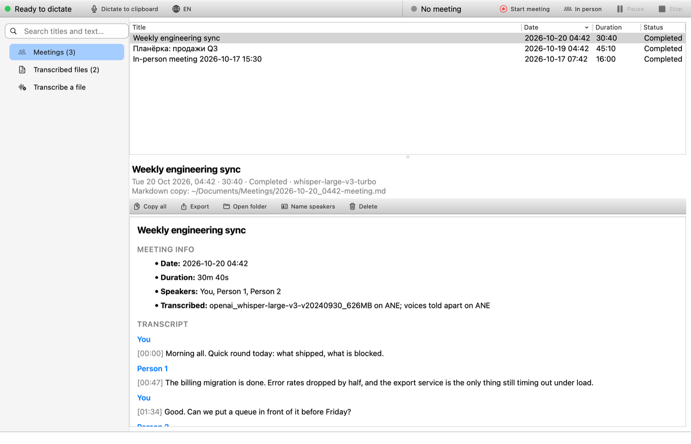
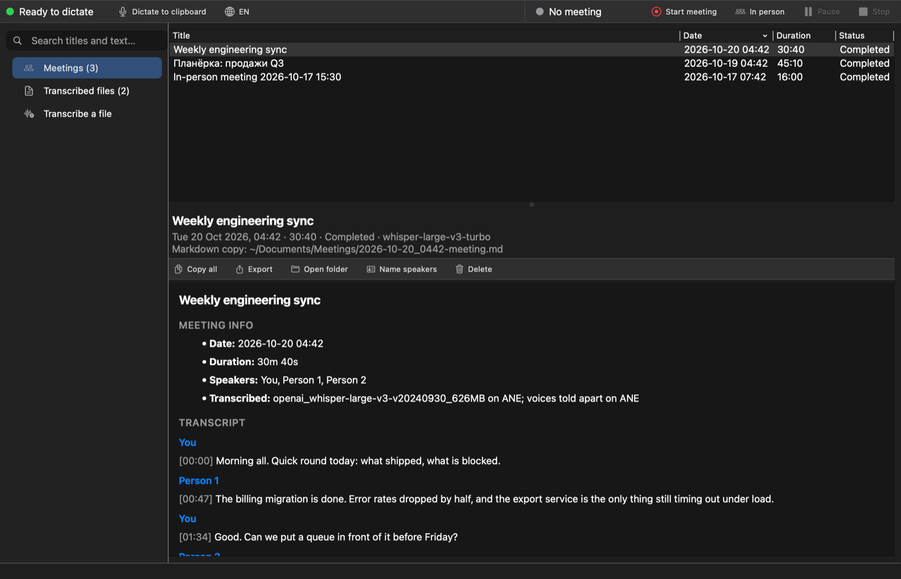

# BMeet on macOS (Apple silicon)

BMeet runs on Macs with Apple silicon (M1 and later) with macOS 14.2 or later. On Linux the speech models run on the Intel NPU. On a Mac they run on the **Neural Engine**, Apple's NPU, and the CPU is only the fallback. The features are the same:
- dictation;
- meeting transcripts with who said what;
- in-person meetings;
- file transcription;
- the app;
- the Chrome mute extension.

The transcription engine (`transcribe/npu-transcribe`), the app and the Chrome extension are shared with Linux. The Mac-only parts live in `macos/`.



## Install

The installer is the same one line as on Linux. On a Mac `install.sh` hands over to `macos/install.sh`:

```bash
curl -fsSL https://raw.githubusercontent.com/baakhoff/bmeet/main/install.sh | bash
```

It goes through nine numbered steps, each with a ✓ and how long it took, a spinner for the long ones and their details in `~/Library/Logs/BMeet/install.log` (on a failure, the last lines of it are shown). Starting from a new Mac:

- **Command Line Tools missing:** macOS shows its own window to install them, and the installer waits.
- **Homebrew missing:** it offers to run Homebrew's official installer, which asks for your password itself.

To try a branch before it is released, name it twice:

```bash
curl -fsSL https://raw.githubusercontent.com/baakhoff/bmeet/macos-port/install.sh | BMEET_REF=macos-port bash
```

What it needs and what it does:

- **Needs:**
  - the Command Line Tools (`xcode-select --install`; Xcode itself is not needed);
  - [Homebrew](https://brew.sh);
  - about 5 GB of free disk.
  - No sudo.
- **Installs:**
  - `python@3.13` and `ffmpeg` with Homebrew;
  - a Python venv in `~/.local/share/bmeet/venv`;
  - the models in `~/.local/share/npu-models` (about 1.6 GB, every download checked against a pinned hash);
  - `~/Applications/BMeet.app`;
  - `npu-transcribe`, `bmeet-ctl` and `bmeet` in `~/.local/bin`.
- **Builds:**
  - BMeet's Swift parts, with the Command Line Tools;
  - the Core ML versions of GigaAM and the speaker models (`macos/prepare-coreml`, a few minutes).
- **Warms up:** macOS compiles each model for the Neural Engine the first time it is loaded (Whisper turbo: about 2 minutes on an M1). The installer does that once at the end, so the first dictation does not wait.

Options are the Linux ones that apply: `--languages "en ru"`, `--no-turbo`, `--no-speakers`, `--no-gigaam`, plus `--no-start` (do not start BMeet.app, and not at login) and `--skip-system` (no Homebrew packages). **Upgrade:** run the installer again. **Uninstall:** `bash ~/.local/share/bmeet/src/uninstall.sh` (`--purge` also deletes the models).

### Permissions

macOS asks once for each, the first time BMeet needs it. All three are for **BMeet**, because everything that records or pastes runs inside BMeet.app.

| Permission | When it is asked | Without it |
|---|---|---|
| Microphone | the first dictation or meeting | nothing can be recorded |
| System Audio Recording | the first meeting | the other side of a call is silent: only *You* is transcribed |
| Accessibility | the first dictation that should be pasted | the text stays on the clipboard (press ⌘V); BMeet says so |

They can be changed later in System Settings → Privacy & Security. BMeet is signed "ad hoc" (no Apple developer certificate), so after an upgrade macOS may ask for them again. To avoid that, sign with an identity of your own: run the installer with `BMEET_SIGN_IDENTITY="Your identity" ./install.sh` (`security find-identity -p codesigning` lists yours).

## Use

BMeet lives in the menu bar: a microphone. It turns red while you dictate or a meeting records, and shows the meeting's time.

| | |
|---|---|
| **⌃⌥H** | dictate: press, speak, press again. The text is pasted where you were typing |
| **⌃⌥⌘H** | the same, but only copied to the clipboard |
| **⌃⌥M** | start or stop a meeting transcript (microphone + system audio) |
| **⌃⌥⇧M** | start or stop an in-person meeting (microphone only, split by voice) |
| **⌃⌥⇧H** | next dictation language |
| Menu bar icon | the same, plus pause and resume, languages, recent transcripts, *Open BMeet…*, settings |
| Finder | right-click audio or video → *Quick Actions* or *Services* → *Transcribe with BMeet*, *… with Speakers*, *Translate Speech to English*, *Open in BMeet* |
| Terminal | `npu-transcribe talk.m4a`, `bmeet-ctl status`, `bmeet` (the window), as on Linux |

While you dictate, a small panel at the bottom of the screen shows the words as you say them. It is underlined while a word may still change, and it floats over full-screen apps too. It never takes the keyboard focus, so the text goes where you were typing. When you stop, BMeet puts the text on the clipboard, presses ⌘V, and gives you your clipboard back. `~/.config/bmeet/live-dictation` saying `off` hides the words (the panel then only shows *Listening…*).

### How it looks

- **The window:** the same window as on Linux, dressed as a Mac app.
  - Its icons are SF Symbols, drawn on your Mac by the installer (`macos/tools/make-symbols.swift`), in light and dark versions.
  - A Finder-style sidebar, Apple's system colors for the states.
  - Transcripts in macOS's type: small gray section labels, the speakers in accent blue, the times in gray.
  - The menus a Mac app has: *View* → Meetings ⌘1, Transcribed Files ⌘2, Transcribe a File ⌘3; ⌘F to search, ⌘O to transcribe files, ⌘, for the settings folder; *Controls* for dictation and meetings.
  - Its texts name ⌃⌥ and Finder where Linux's name Meta and Dolphin.
- **The menu bar:** each item has an SF Symbol, and the shortcuts show the Mac way, from the same `hotkeys` file. The first line shows the state with a colored dot.
- **The dictation panel:** a red dot pulses while BMeet listens, next to the language.



## Settings

The same files as on Linux, in `~/.config/bmeet`. The menu's *Settings* changes the common ones.

| File | |
|---|---|
| `languages` | the dictation languages ⌃⌥⇧H cycles through, e.g. `en ru` (the installer's default: English + your Mac's languages) |
| `language` | the current dictation language (on Linux it is in voxtype's config) |
| `live-dictation` | `on` (default on a Mac) or `off`: the words while you speak |
| `speakers` | `on` / `off`: tell meeting speakers apart (Person 1, Person 2, …) |
| `remember-voices` | as on Linux: set in the app's *Name speakers…* |
| `start-at-login` | `on` / `off` (the menu's *Start BMeet at login*) |
| `hotkeys` | other shortcuts, one per line: `dictate = ctrl+option+h`, `dictate-clipboard`, `language`, `meeting`, `meeting-in-person`; modifiers `ctrl`, `option`, `cmd`, `shift`; `none` turns one off. BMeet reads it when it starts |

## How it works

```
 ⌃⌥H / menu ──┐
 ⌃⌥M / menu ──┼─> BMeet.app (menu bar, Swift) ─┬─> npu-transcribe --dictate ──> bmeet-record raw (microphone)
 bmeet-ctl ───┘   agent.sock                   │       text events -> the panel; ⌘V at the end
                                               └─> bmeet-meeting start|stop (Python)
                                                     ├─ RAM disk on $XDG_RUNTIME_DIR/bmeet/meeting-audio
                                                     ├─ bmeet-record meeting DIR   (mic + Core Audio tap of the system audio)
                                                     ├─ npu-transcribe --live DIR  (live.md: You / Remote)
                                                     └─ npu-transcribe --meeting   (the speaker pass) -> ~/Documents/Meetings

 npu-transcribe ─┬─> bmeet-whisper (WhisperKit, Core ML, one server for all) ──────────> Neural Engine
                 ├─> GigaAM v3 (Core ML program built by macos/prepare-coreml) ────────> Neural Engine
                 └─> Nemotron 3 Diarization + TitaNet (Core ML programs) ──────────────> Neural Engine
```

| Linux | macOS |
|---|---|
| Whisper with OpenVINO GenAI on the NPU, in each process | **bmeet-whisper** (`macos/Sources/bmeet-whisper`): [WhisperKit](https://github.com/argmaxinc/argmax-oss-swift) (Argmax, MIT) runs Whisper large-v3-turbo as Core ML models, encoder and decoder on the Neural Engine. One server holds the model for every process: an 8 GB Mac loads it once. Dictation goes first, then the live transcript, then files. It exits after 10 idle minutes. The models are pinned in `macos/models/whisperkit.tsv` (`openai_whisper-large-v3-v20240930_626MB`, and `openai_whisper-small_216MB` for `--translate`) |
| GigaAM, Nemotron, TitaNet with OpenVINO on the NPU | the same pinned files, built into **Core ML programs** by `macos/prepare-coreml` (see below) and run with coremltools on the Neural Engine |
| voxtype: the dictation daemon and meetings | **BMeet.app**: dictation, through the same `npu-transcribe --dictate` engine as the Linux text-while-you-speak. **`macos/bmeet-meeting`**: meetings, with voxtype's state files and voxtype's meeting index columns (`~/.local/share/bmeet/meetings/index.db`), so bmeet-ctl and the app read both alike |
| pw-record, bmeet-meeting-audio | **bmeet-record** (`macos/Sources/bmeet-record`): the microphone (AVAudioEngine) and the system audio, a Core Audio process tap of every process (macOS 14.2+). Both are written as 16 kHz mono WAV parts, the layout of bmeet-meeting-audio, and lined up by their hardware timestamps |
| `$XDG_RUNTIME_DIR` (tmpfs) | macOS has no such variable: `macos/bmeetmac.py` points it at your user's temp folder, the same for every process. The meeting audio goes to a RAM disk that bmeet-meeting mounts there (hidden from Finder) and detaches when no recording is left: it never reaches the disk |
| systemd user units | bmeet-meeting's "units": detached processes with pid files in `$XDG_RUNTIME_DIR/bmeet/units`, and what to run when each ends |
| KDE shortcuts, the panel widget | BMeet.app's shortcuts (Carbon hot keys: no Input Monitoring permission) and its menu bar icon |
| ydotool / wl-copy, KWin's input method | the clipboard, ⌘V (CGEvent; Accessibility), and the panel at the bottom of the screen |
| Dolphin service menu | BMeet.app's Services (Finder → Quick Actions / Services) |
| notify-send | BMeet.app's notifications (`bmeetmac.notify`) |
| The app on the system PyQt6 | the same app on the venv's PyQt6, inside `BMeet.app/Contents/Helpers/BMeet Window.app`: `macos/window/launcher.c` runs Python inside that bundle, so macOS shows *BMeet* with its icon, not *Python* |

### The models on the Neural Engine

The Neural Engine computes in float16 and only Core ML can reach it. ONNX Runtime's Core ML backend keeps an ONNX model in float32 and so leaves it on the CPU. On an M1, TitaNet ran exactly as fast with the Neural Engine allowed as without, and its output was bit-identical to the CPU's. So `macos/prepare-coreml` builds real Core ML programs at install time:

- **GigaAM v3 and TitaNet:** the ONNX model gets fixed input shapes and is constant-folded by ONNX Runtime's basic optimiser, which turns all shape arithmetic into constants. It is then translated op by op into an ML Program (`OnnxToMil`: the ~35 ONNX ops these two use) and saved with float16 compute precision. GigaAM's int8 weights are turned back into float first, by `prepare-models`' `dequantize`, as for the NPU. TitaNet gets the same float16 fix as on the NPU (`titanet_fp16_safe`: its statistics pooling underflows in float16).
- **Nemotron 3 Diarization:** built from its weights by `transcribe/prepare-diarization`'s own graph code (`build_graph`), with Core ML ops in place of OpenVINO's (`MilOps`). It is the same model as on the NPU.
- **Checks:** each build is checked against the CPU, and Core ML's compute plan is asked where each op runs.

Measured on an M1 with 8 GB (macOS 27):

| Model | On the Neural Engine | Check against the CPU |
|---|---|---|
| Whisper large-v3-turbo (WhisperKit 626 MB) | a 23 s English talk in 3.0 s (7.7× real time), every word right; first load ever 137 s, then 1.7 s | — |
| GigaAM v3 | 112 ms per 30 s block (~270× real time); 1148 of 1162 ops on the Neural Engine | 100 % of the output frames agree |
| TitaNet-small | 44 ms per 16 fingerprints (the CPU: 420 ms); 132 of 156 ops | 0.9998 alike at worst |
| Nemotron 3 Diarization | 72 ms per 27 s step; 1137 of 1140 ops | 100 % of the 10 ms voice decisions agree with float32 |
| A 20 s meeting's speaker pass | 8 s, 1 s of CPU | — |

Whisper is the slow part. A 30 s window takes about 1 s in the encoder and ~30 tokens per second in the decoder. That is slower than the GPU would be, and that is the point: like the NPU on Linux, it leaves the CPU and the GPU to your calls and apps. Russian goes to GigaAM, which is ~35× faster than Whisper.

## Differences from Linux

- **No text into the field while you speak:** on Linux BMeet can be KWin's input method. On a Mac the words show in the floating panel and are pasted when you stop.
- **No pyannote fallback** for telling voices apart. The Mac install always has Nemotron, and ONNX Runtime, which pyannote would need, crashes next to Core ML in one process.
- **One Whisper model:** dictation uses Whisper turbo, like files and meetings; Linux's voxtype uses Whisper small. It is fast enough on the Neural Engine, and it is already loaded.
- **The meeting audio is always recorded while a meeting runs** (in RAM): there is no voxtype that transcribes it itself. With `speakers` off it is deleted as soon as the live transcript is done, instead of after the speaker pass.

## Development

```bash
swift build -c release --package-path macos                 # BMeet, bmeet-whisper, bmeet-record (Command Line Tools)
macos/.build/release/bmeet-whisper transcribe talk.f32 --words   # raw float32 16 kHz mono -> JSON
QT_QPA_PLATFORM=offscreen ~/.local/share/bmeet/venv/bin/python -I bmeet/app/tests/test_bmeet.py   # the app's tests
~/.local/share/bmeet/venv/bin/python -I macos/tests/test_macos.py                               # the Mac parts
```

- The app's tests run the Linux window with a fake voxtype on a Mac too: they set `BMEET_PLATFORM=linux`, which bmeet-ctl and the app read.
- `macos/tests/test_macos.py` tests the Mac parts without models or permissions:
  - the WhisperKit server protocol, with a stand-in;
  - bmeet-record, playing files instead of the devices (`BMEET_RECORD_MIC_FILE`, `BMEET_RECORD_SYSTEM_FILE`): parts, pauses, WAV headers;
  - bmeet-meeting's start, pause, stop and index, without the RAM disk (`BMEET_NO_RAMDISK=1`);
  - bmeet-ctl's Mac commands.
- The native parts build with the Command Line Tools alone (`swift build`). WhisperKit is pinned in `macos/Package.resolved`.

## Troubleshooting

- **Nothing happens on ⌃⌥H:**
  - Is BMeet in the menu bar? If not, open `~/Applications/BMeet.app`.
  - Is the shortcut taken? See `~/Library/Logs/BMeet` and the `hotkeys` file.
- **The dictated text does not appear:** allow BMeet in System Settings → Privacy & Security → Accessibility (the menu's *Settings → Allow pasting*). Until then, the text is on the clipboard.
- **A meeting has only *You*:** allow BMeet in System Settings → Privacy & Security → *Screen & System Audio Recording*, under *System Audio Recording Only*.
- **Logs:**
  - `~/Library/Logs/BMeet/` (dictation, meetings, file jobs);
  - `$(getconf DARWIN_USER_TEMP_DIR)bmeet/whisper.log` (the Whisper server);
  - `$(getconf DARWIN_USER_TEMP_DIR)bmeet/units/*.log` (a meeting's recorder, live transcript, speaker pass).
- **Check everything:** `bash ~/.local/share/bmeet/src/macos/verify.sh`
- **Ask for a permission again:** `tccutil reset Microphone io.github.baakhoff.bmeet`, and the same with `Accessibility` or `AudioCapture`.
